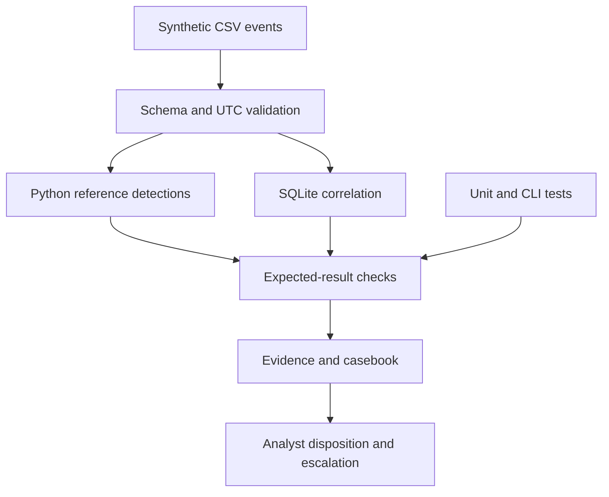

# Five-minute reviewer guide

**Target roles:** SOC Analyst I, Junior Cybersecurity Analyst, Security Operations Analyst,
and junior GRC roles. This is a simulated learning portfolio, not employment experience.

| Time | Review | What it demonstrates |
|---|---|---|
| Minute 1 | [Casebook](CASEBOOK.md) | Evidence-based triage, uncertainty and escalation |
| Minute 2 | [Raw events](../lab/auth_events.csv) and [alerts](../evidence/alerts.json) | Traceable event-to-alert reasoning |
| Minute 3 | [Python](../lab/detections.py) and [SQL](../lab/correlation.sql) | Event ordering, grouping and time windows |
| Minute 4 | [Tests](../tests/) and [manifest](../evidence/manifest.json) | Reproducibility, failure handling and negative cases |
| Minute 5 | [GRC linkage](RISK_AND_CONTROLS.md) and [limitations](VALIDATION.md) | Business-risk interpretation and honest scope |

## Additional technical evidence

- [Endpoint/network case](FORENSIC_CASE.md): raw XML and PCAP, GUID correlation, packet-number references and an independent decoder.
- [Rolling evaluation](ROLLING_AND_EVALUATION.md): 72 labeled scenarios, explicit negative controls and limits on what the scores mean.

## Interview demonstration

Run `python -m lab.reproduce`. Explain why A06 qualifies and B01 does not, why C04 is outside
the window, and why E02 needs enrichment. Show one boundary test and one dry-run test.
Then explain what you would need to validate the same rule inside Splunk.

## Questions this portfolio prepares you to answer

- What evidence would change your disposition from suspicious to confirmed malicious?
- Why correlate on both user and source, and what attacks could that grouping miss?
- What happens at exactly 300 seconds, at a fixed-bin boundary, or with equal timestamps?
- How would you suppress repeated alerts without losing supporting events?
- How do you distinguish a passing test from proof of production readiness?
- How does an operational detection support a risk treatment and who approves containment?

## Architecture

